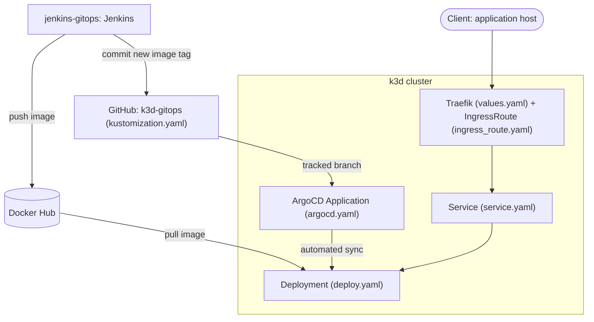

# k3d-gitops

| Repository | Role | Relation to this repository |
|---|---|---|
| [k3d-gitops](https://github.com/smallestcontainer/k3d-gitops) | CD | This repository |
| [url-shortener](https://github.com/smallestcontainer/url-shortener) | Application | The service whose image these manifests deploy |
| [jenkins-gitops](https://github.com/smallestcontainer/jenkins-gitops) | CI | Jenkins server that builds, checks and publishes the image deployed here |

Kubernetes manifests for deploying the
[url-shortener](https://github.com/smallestcontainer/url-shortener) application to a local
[k3d](https://k3d.io/) cluster (k3s in Docker), exposed through the
[Traefik](https://traefik.io/) ingress controller.

This repository is the CD part of a GitOps pipeline. Jenkins
([jenkins-gitops](https://github.com/smallestcontainer/jenkins-gitops)) builds and
publishes the application image to Docker Hub and commits the new image tag here;
[ArgoCD](https://argo-cd.readthedocs.io/) watches this repository and keeps the cluster
in sync with it.

## Architecture



ArgoCD renders the repository with Kustomize and applies the result to the destination
namespace set in `argocd.yaml`. Its sync policy enables automated sync with pruning and
self-heal: resources removed from Git are deleted from the cluster, and manual changes in
the cluster are reverted to the state in Git.

| File | Kind | Description |
|---|---|---|
| `argocd.yaml` | ArgoCD `Application` | Source repository and branch, destination namespace and sync policy |
| `kustomization.yaml` | Kustomize config | Lists the resources ArgoCD deploys and sets the image tag; Jenkins updates the tag after each release build |
| `deploy.yaml` | `Deployment` | Runs the url-shortener image: image name, replica count, container port and pod labels |
| `service.yaml` | `Service` | ClusterIP service in front of the Deployment's pods, selected by their labels |
| `ingress_route.yaml` | Traefik `IngressRoute` | Routes the application host from Traefik's web entry point to the Service |
| `values.yaml` | Helm values for Traefik | Enables the Traefik dashboard on its own host and the Kubernetes Gateway API provider |

## Installation

### Requirements

- Docker
- [k3d](https://k3d.io/#installation)
- [kubectl](https://kubernetes.io/docs/tasks/tools/)
- [Helm](https://helm.sh/docs/intro/install/) (to install Traefik with `values.yaml`)

### 1. Clone

```bash
git clone git@github.com:smallestcontainer/k3d-gitops.git
cd k3d-gitops
```

### 2. Create the cluster

Map the host's HTTP port to the k3d load balancer. Disabling the Traefik bundled with k3s
lets you install it via Helm with the `values.yaml` from this repository:

```bash
k3d cluster create gitops \
  -p "80:80@loadbalancer" \
  --k3s-arg "--disable=traefik@server:0"
```

### 3. Install Traefik

```bash
helm repo add traefik https://traefik.github.io/charts
helm repo update
helm install traefik traefik/traefik \
  --namespace traefik --create-namespace \
  -f values.yaml
```

`values.yaml` enables the Gateway API provider. Depending on the chart version,
you may need to install the Gateway API CRDs first. See the
[Traefik Gateway API documentation](https://doc.traefik.io/traefik/providers/kubernetes-gateway/).

### 4. Install ArgoCD

```bash
kubectl create namespace argocd
kubectl apply -n argocd --server-side --force-conflicts \
  -f https://raw.githubusercontent.com/argoproj/argo-cd/stable/manifests/install.yaml
kubectl -n argocd rollout status deployment/argocd-server
```

### 5. Register the application

```bash
kubectl apply -f argocd.yaml
```

ArgoCD pulls this repository from GitHub and deploys it. The repository must be public,
or added to ArgoCD with credentials.

### 6. Verify

```bash
kubectl -n argocd get application shortener   # SYNC STATUS: Synced, HEALTH STATUS: Healthy
```

On most systems `*.localhost` resolves to `127.0.0.1`, so no changes to
`/etc/hosts` are needed.

```bash
curl -X POST http://shortener.localhost/ \
  -H 'Content-Type: application/json' \
  -d '{"url": "https://example.com"}'
```

- Application: the host from `ingress_route.yaml` (API docs at `/docs`)
- Traefik dashboard: the dashboard host from `values.yaml`

## Usage

Changes to the cluster go through Git: commit to the branch tracked in `argocd.yaml`,
and ArgoCD applies them. New images are rolled out automatically: after a release build
Jenkins pushes a commit that sets the new tag in `kustomization.yaml`.
To roll back, revert that commit. Changes made directly with `kubectl` are reverted
by self-heal.

```bash
kubectl -n argocd get application shortener   # sync and health status
kubectl get deploy,svc,pods -l app=shortener   # deployed resources
kubectl logs -l app=shortener -f --prefix      # logs from all replicas

k3d cluster stop gitops     # pause the cluster
k3d cluster start gitops    # resume the cluster
```

ArgoCD web UI:

```bash
kubectl -n argocd get secret argocd-initial-admin-secret \
  -o jsonpath='{.data.password}' | base64 -d; echo   # password for the admin user
kubectl -n argocd port-forward svc/argocd-server 8080:443
```

Then open https://localhost:8080 and log in as `admin`.

## Removal

```bash
kubectl delete -f argocd.yaml                                         # stop syncing
kubectl delete -f deploy.yaml -f service.yaml -f ingress_route.yaml   # remove the application
kubectl delete namespace argocd                                       # remove ArgoCD
helm uninstall traefik --namespace traefik                            # remove Traefik
k3d cluster delete gitops                                             # delete the whole cluster
```

The `Application` has no deletion finalizer, so deleting it leaves the deployed resources
in place. Deleting the cluster removes everything at once, so the other commands are
only needed if you want to keep the cluster.
